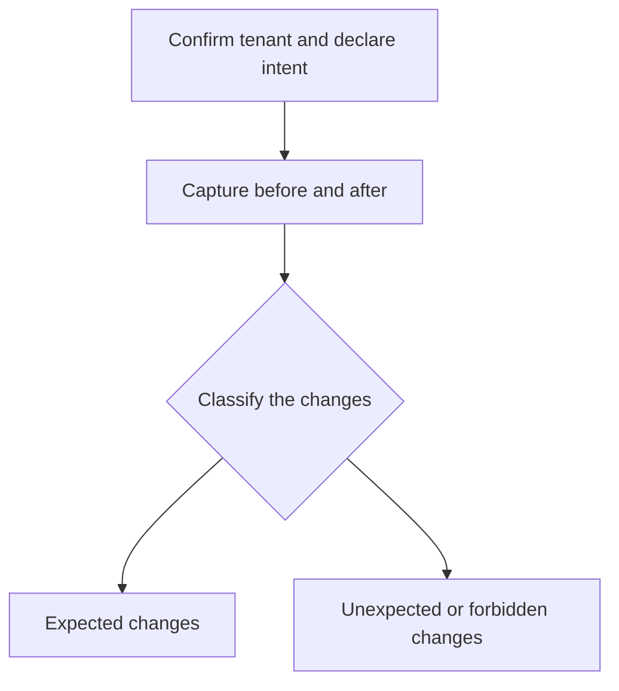

  

  <a href="https://www.linkedin.com/in/nara-oliveira-16aa03204/">LinkedIn</a> ·
  <a href="https://github.com/NaraOli0304/ChangePack365">Explore ChangePack365</a>

## ChangePack365

A PowerShell toolkit for collecting and verifying evidence of Microsoft 365 changes. The experimental MVP records the intended change, captures before-and-after state, and exports a privacy-safe report backed by a hash-chained ledger.

[Source and documentation](https://github.com/NaraOli0304/ChangePack365) · [CI runs](https://github.com/NaraOli0304/ChangePack365/actions/workflows/test.yml)

## More projects

| Project | What it demonstrates |
| :--- | :--- |
| **[NaraWorkstation](https://github.com/NaraOli0304/NaraWorkstation)** | Reproducible Windows 11 setup with chezmoi, CI checks for sensitive data, and a tested Windows Sandbox restore. |
| **[NaraSnippets](https://github.com/NaraOli0304/NaraSnippets)** | Espanso shortcuts for recurring PowerShell, GitHub, and Microsoft 365 workflows. |

## Technical focus

**Identity** · Entra ID, Conditional Access, MFA  
**Endpoint and collaboration** · Intune, Exchange Online, SharePoint, Teams  
**Security and automation** · Purview, PowerShell, Microsoft Graph, GitHub Actions
